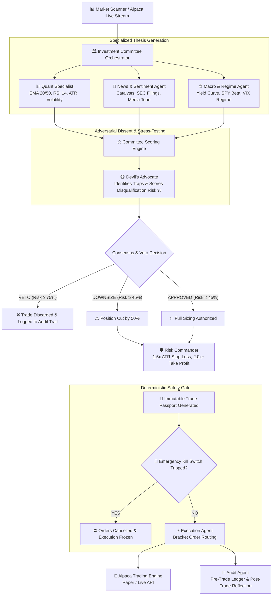

# 🛡️ ARGUS AI: Autonomous Multi-Agent Trading Desk

> *"We didn't build an AI that blindly trades. We built an AI trading desk that knows when to question itself, when to refuse a trade, and when to shut itself down."*

[](https://www.python.org/)
[](LICENSE)
[](https://alpaca.markets/)
[](tests/)
[](https://lablab.ai/ai-hackathons/alpaca-ai-trading-agents-hackathon)

---

## 📌 Executive Summary

Conventional AI trading bots suffer from a fatal flaw: **confirmation bias and blind execution**. When a single predictive model spots momentum, it executes without considering liquidity traps, impending macro releases, or adversarial counter-theses.

**ARGUS AI** introduces an institutional **Multi-Agent Investment Committee with Adversarial Dissent**:
1. **Specialized Thesis Agents (Quant, News, Macro)** analyze opportunities independently.
2. **The Devil's Advocate Agent** ruthlessly challenges the trade idea, detects hidden traps, and holds **unilateral VETO power**.
3. **Risk Commander & Circuit Breakers** enforce deterministic position sizing (1.5x ATR stops, 2:1 profit targets) and halt the desk if daily risk budgets are breached.
4. **Alpaca Execution Engine** dispatches compliant bracket orders with cryptographic **Trade Passports** logged for auditability.

---

## 🏛️ System Architecture



---

## 🤖 The 7-Agent Investment Committee

| Agent | Responsibility | Core Metrics / Output |
| :--- | :--- | :--- |
| **1. Quant Specialist** | Technical indicators, momentum, moving average trends | EMA 20/50 alignment, RSI 14, ATR 14, Volume surge % |
| **2. News & Sentiment Agent** | Financial headlines, corporate filings, social sentiment | Sentiment polarity score (-100 to +100), catalyst urgency |
| **3. Macro & Sector Agent** | Broad market regime, interest rate environment, VIX | SPY/QQQ Beta, yield curve delta, sector relative strength |
| **4. Devil's Advocate** | **Adversarial stress-testing & trap identification** | **Disqualification Risk % (0-100), VETO trigger, trap warnings** |
| **5. Risk Commander** | Capital budgeting, bracket calculations, position sizing | 1.5x ATR Stop Loss, 2:1 Take Profit, max 1.0% account risk |
| **6. Execution Agent** | Order formatting & dispatch to Alpaca broker | Fractional shares, bracket orders, client order IDs |
| **7. Audit Agent** | Full deliberation transcript recording & post-trade review | Immutable JSON Trade Passports, post-mortem reflections |

---

## 📜 The Immutable Trade Passport

Every trade proposed by ARGUS AI generates an auditable **Trade Passport** containing complete decision provenance:

```json
{
  "passport_id": "PASSPORT-20260828-NVDA01",
  "ticker": "NVDA",
  "direction": "LONG",
  "current_price": 148.50,
  "consensus": {
    "status": "VETOED",
    "composite_score": -45.0,
    "overall_confidence": 0.72,
    "downsize_factor": 0.0,
    "main_opposition": "Overbought Momentum Trap: RSI 76.2 + VIX 26.4"
  },
  "devils_advocate": {
    "disqualification_risk_pct": 84.0,
    "veto_recommended": true,
    "identified_traps": [
      "Overbought exhaustion: RSI 76.2 historically reverts into 20 EMA",
      "High Volatility flush vulnerability with VIX at 26.4",
      "Inverted Risk/Reward profile (< 0.8:1)"
    ]
  },
  "shares_or_contracts": 0,
  "account_risk_usd": 0.0,
  "execution_status": "VETOED_BEFORE_DISPATCH"
}
```

---

## ⚡ Emergency Kill Switch Circuit Breakers

The **Emergency Kill Switch** monitors portfolio health in real-time and acts as an institutional circuit breaker:
- 📉 **Max Daily Drawdown Guard**: Halts all trading if portfolio drops $\ge 3.0\%$ from peak daily equity.
- 🛑 **Consecutive Loss Streak Guard**: Automatically suspends trading after 3 consecutive stop-outs.
- 🌊 **Macro Volatility Spike Guard**: Freezes entries if market VIX spikes $\ge 38.0$.
- ⚡ **Automated Liquidation & Cancellation**: Immediately cancels all open Alpaca working orders upon engagement.

---

## 🚀 Quickstart & Installation

### 1. Prerequisites
- Python 3.10+
- (Optional) Alpaca Paper Trading API Keys
- (Optional) Google Gemini API Key for dynamic LLM committee deliberation

### 2. Clone and Setup
```bash
git clone https://github.com/codesphereug/ARGUS-AI.git
cd "ria forex bot"

# Create and activate virtual environment
python -m venv .venv
source .venv/bin/activate  # Linux/macOS
.venv\Scripts\Activate.ps1 # Windows

# Install dependencies
pip install -r requirements.txt
```

### 3. Environment Configuration
Create a `.env` file from `.env.example`:
```ini
# Alpaca Trading API (Leave blank for High-Fidelity Simulation Mode)
ALPACA_API_KEY=your_alpaca_api_key_here
ALPACA_SECRET_KEY=your_alpaca_secret_key_here
ALPACA_BASE_URL=https://paper-api.alpaca.markets

# Google Gemini AI (Leave blank for Deterministic Heuristic Engine)
GEMINI_API_KEY=your_gemini_api_key_here
```

---

## 💻 Running ARGUS AI

### 1. Interactive Web Demo & Visual Dashboard
Launch the modern glassmorphism desk UI:
```bash
python -m http.server 3000 --directory "argus_dashboard"
```
Open **[http://localhost:3000](http://localhost:3000)** to view the live committee chamber, trigger the kill switch, and inspect trade passports.

### 2. Rich CLI Deliberation
Run a market scan across major equities & crypto:
```bash
python -m argus_ai.cli scan
```

Evaluate a specific ticker:
```bash
python -m argus_ai.cli single --ticker NVDA
```

Run the Adversarial Self-Dissent Demonstration:
```bash
python -m argus_ai.cli adversarial-demo
```

---

## 🧪 Automated Test Suite

Run the full unit and integration test suite:
```bash
python -m pytest
```

All 49 tests cover:
- Multi-agent scoring and consensus synthesis
- Devil's Advocate adversarial veto and downsize thresholds
- Risk Commander ATR bracket calculations
- Emergency Kill Switch state transitions and order purging
- Alpaca high-fidelity paper trading simulation

---

## 📚 Detailed Documentation

- 📐 **[System Architecture & Math Specs](docs/ARCHITECTURE.md)**
- 🤝 **[Team Contribution Guide](docs/CONTRIBUTING.md)**
- 🏆 **[Hackathon Pitch & Demo Kit](docs/HACKATHON_KIT.md)**
- 📜 **[Trade Passport Specification](docs/TRADE_PASSPORT_SPEC.md)**

---

## 📄 License
This project is licensed under the MIT License — see the [LICENSE](LICENSE) file for details.
