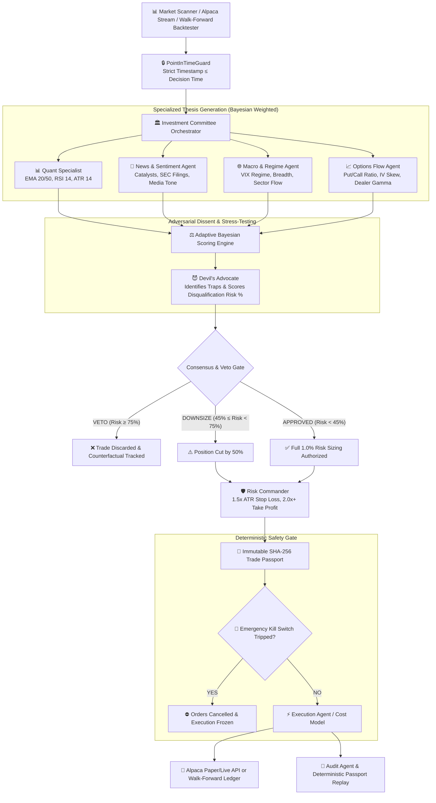

# 🛡️ ARGUS AI: Autonomous Multi-Agent Investment Committee & Trading Desk

> *"We didn't build an AI that blindly trades. We built an AI trading desk that knows when to question itself, when to refuse a trade, and when to shut itself down."*

[](https://www.python.org/)
[](CHANGELOG.md)
[](LICENSE)
[](https://alpaca.markets/)
[](tests/)
[](docs/MCP_INTEGRATION_GUIDE.md)

> **⚠️ Simulation & Risk Disclaimer:** ARGUS AI is an open-source multi-agent quantitative engineering and research platform. By default, it runs in **Offline Deterministic Simulation / Paper-Trading Mode** (`https://paper-api.alpaca.markets`) with zero live capital at risk. Nothing in this repository constitutes financial or investment advice.

---

## 📌 Executive Summary

Conventional AI trading bots suffer from a fatal flaw: **confirmation bias and blind execution**. When a single predictive model spots momentum, it executes without considering liquidity traps, volatility spikes, or adversarial counter-theses.

**ARGUS AI (v2.1)** introduces an institutional **Multi-Agent Investment Committee with Adversarial Dissent, Point-in-Time Backtesting, and Cryptographic Decision Replay**:
1. **Specialized Thesis Agents (`Quant`, `News`, `Macro`, `Options Flow`)** evaluate opportunities independently and combine votes via **Adaptive Bayesian Weights**.
2. **The Devil's Advocate Agent** ruthlessly challenges the proposed trade, identifies structural bull/bear traps, and holds **unilateral VETO (`Risk >= 75%`) and 50% Downsize (`Risk >= 45%`) power**.
3. **Risk Commander & Circuit Breakers** enforce deterministic position sizing (`1.5x ATR` stops, `2:1` profit targets, max `1.0%` equity risk) and halt the desk if daily drawdown or consecutive loss limits are breached.
4. **Deterministic Walk-Forward Backtester & Passport Replay (`argus_ai/backtest.py`)** enforces strict point-in-time anti-leakage checks (`PointInTimeGuard`), models realistic spread/commission/ATR-slippage costs (`ExecutionCostModel`), quantifies counterfactual **Veto Saved Loss**, and verifies SHA-256 `TradePassport` digests (`replay_passport`).

---

## 🏛️ System Architecture



---

## 🤖 The Investment Committee Roster

| Agent | Responsibility | Core Metrics / Output |
| :--- | :--- | :--- |
| **1. Quant Specialist** | Technical indicators, momentum, moving average alignment | EMA 20/50 structure, RSI 14, ATR 14, Volume surge |
| **2. News & Sentiment Agent** | Financial headlines, corporate filings, catalyst polarity | Sentiment score (`-100` to `+100`), catalyst urgency |
| **3. Macro & Sector Agent** | Broad market regime, VIX implied volatility, breadth | VIX regime tiers (`<15`, `15-22`, `22-30`, `>30`), regime state |
| **4. Options Flow Agent** | Institutional sweep activity, Put/Call ratios, dealer gamma | Put/Call skew, IV rank penalty, gamma pin support |
| **5. Devil's Advocate** | **Adversarial stress-testing & trap identification** | **Disqualification Risk % (`0-100`), unilateral VETO / 50% Downsize** |
| **6. Risk Commander** | Capital budgeting, bracket calculations, position sizing | `1.5x ATR` Stop Loss, `2:1` Take Profit, max `1.0%` equity risk |
| **7. Execution & Audit Agents** | Pre-flight kill-switch check, order routing & SHA-256 replay | Immutable JSON `TradePassport`, post-trade attribution & digest check |

---

## 📊 Walk-Forward Backtest & Counterfactual Veto Benchmark

ARGUS AI includes a deterministic walk-forward backtesting engine ([`argus_ai/backtest.py`](argus_ai/backtest.py)) that evaluates the **Full ARGUS Committee** side-by-side against a **Naive Single-Agent Quant Baseline** on identical multi-regime price streams (Constructive Bull Trend, Euphoric Blow-Off & Flash-Crash Bull Traps, Extended Rally, and Recovery Trend) under strict `PointInTimeGuard` enforcement and realistic transaction costs (`4.0 bps` spread, `1.5 bps/side` commission, `4.0% ATR` volatility slippage):

| Institutional Metric | 🛡️ ARGUS 7-Agent Committee | 🤖 Naive Quant Baseline | 📈 ARGUS Structural Edge |
| :--- | :---: | :---: | :---: |
| **Starting Equity** | `\$100,000.00` | `\$100,000.00` | — |
| **Ending Equity** | **`\$101,172.57`** | `\$99,886.52` | **`\$+1,286.05`** |
| **Total Net Return (%)** | **`+1.17%`** | `-0.11%` | **`+1.28%`** |
| **Max Drawdown (%)** | **`0.41%`** | `1.89%` | **`-1.48% DD Reduction`** |
| **Sharpe Ratio (Ann.)** | **`6.54`** | `-0.38` | **`+6.92`** |
| **Sortino Ratio (Ann.)** | **`9.74`** | `-0.97` | **`+10.71`** |
| **Win Rate (%)** | **`68.2%`** | `47.2%` | `+21.0%` |
| **Profit Factor** | **`2.48`** | `0.96` | `+1.52` |
| **Executed Trades** | `22` | `36` | `-14 (Selective Filtering)` |
| **Transaction Costs Paid** | `\$289.32` | `\$490.31` | `\$-200.99` |
| **Devil's Advocate Vetoes** | **`3 (100% Precision)`** | `0` | **`\$488.37 Loss Avoided`** |

📄 See the full reproducible report in **[`docs/BACKTEST_VERIFICATION_REPORT.md`](docs/BACKTEST_VERIFICATION_REPORT.md)**.

---

## 📜 The Immutable Trade Passport & Deterministic Replay

Every trade evaluated by ARGUS AI generates an auditable **Trade Passport** that can be cryptographically hashed (`compute_passport_digest`) and verified offline (`replay_passport`):

```json
{
  "passport_id": "PASSPORT-20260828-NVDA01",
  "ticker": "NVDA",
  "direction": "LONG",
  "current_price": 148.50,
  "consensus": {
    "status": "VETOED",
    "composite_score": -45.0,
    "overall_confidence": 0.72,
    "downsize_factor": 0.0,
    "main_opposition": "Overbought Momentum Trap: RSI 76.2 + VIX 26.4"
  },
  "devils_advocate": {
    "disqualification_risk_pct": 84.0,
    "veto_recommended": true,
    "identified_traps": [
      "Overbought exhaustion: RSI 76.2 historically reverts into 20 EMA",
      "High Volatility flush vulnerability with VIX at 26.4",
      "Inverted Risk/Reward profile (< 0.8:1)"
    ]
  },
  "shares_or_contracts": 0,
  "account_risk_usd": 0.0,
  "execution_status": "REJECTED_BY_RISK"
}
```

---

## ⚡ Emergency Kill Switch Circuit Breakers

The **Emergency Kill Switch** ([`argus_ai/core/kill_switch.py`](argus_ai/core/kill_switch.py)) monitors portfolio telemetry in real-time and acts as an institutional circuit breaker:
- 📉 **Max Daily Drawdown Guard**: Halts all trading if portfolio drops `>= 3.0%` from peak daily equity.
- 🛑 **Consecutive Loss Streak Guard**: Automatically suspends trading after `3` consecutive stop-outs.
- 🌊 **Macro Volatility Spike Guard**: Freezes entries if market VIX spikes `>= 38.0`.
- ⚡ **Automated Order Purging**: Immediately cancels all open Alpaca working orders upon engagement.

---

## 🚀 Quickstart & Installation

### 1. Prerequisites
- Python 3.10+
- (Optional) Alpaca Paper Trading API Keys
- (Optional) Google Gemini API Key for live LLM committee deliberation (falls back automatically to deterministic heuristics when omitted)

### 2. Clone and Install
```bash
git clone https://github.com/codesphere-u/ARGUS-AI.git
cd ARGUS-AI

# Create and activate virtual environment
python -m venv .venv
source .venv/bin/activate  # Linux/macOS

# Install core package + test dependencies
pip install -e ".[dev]"
```

### 3. Environment Configuration
Create a `.env` file from `.env.example`:
```ini
# Alpaca Trading API (Leave blank for Offline Deterministic Simulation Mode)
ALPACA_API_KEY=your_alpaca_api_key_here
ALPACA_SECRET_KEY=your_alpaca_secret_key_here
ALPACA_BASE_URL=https://paper-api.alpaca.markets

# Google Gemini AI (Leave blank for Deterministic Heuristic Engine)
GEMINI_API_KEY=your_gemini_api_key_here
```

---

## 💻 Running ARGUS AI

### 1. Walk-Forward Backtest & Counterfactual Veto Benchmark
```bash
python -m argus_ai.cli backtest --ticker NVDA --bars 240 --report-out docs/BACKTEST_VERIFICATION_REPORT.md
```

### 2. Deterministic Trade Passport Replay & Invariant Audit
```bash
python -m argus_ai.cli replay --ticker NVDA
# Or verify a saved TradePassport JSON file:
python -m argus_ai.cli replay --passport argus_ai/data/passports/<PASSPORT_ID>.json
```

### 3. Rich CLI Market Deliberation & Adversarial Self-Refusal Demo
```bash
# Scan full watchlist
python -m argus_ai.cli scan

# Evaluate single asset with custom regime and VIX
python -m argus_ai.cli single --ticker NVDA --regime BULLISH --vix 16.5

# Run the Adversarial Self-Dissent Veto Demonstration
python -m argus_ai.cli adversarial-demo
```

### 4. MCP Server, WebSocket Stream & Visual Dashboard
```bash
# Launch Model Context Protocol (MCP) Server over stdio for Claude Desktop / Cursor
python -m argus_ai.cli mcp

# Inspect Adaptive Bayesian Agent Weights
python -m argus_ai.cli weights

# Launch Interactive Web Dashboard
python -m http.server 3000 --directory "argus_dashboard"
```

---

## 🧪 Automated Test Suite

Run the full 61-test unit and integration suite:
```bash
pytest -v
```

All **61 tests** run deterministically offline in `< 1.0s` and verify:
- Point-in-time lookahead leakage prevention (`PointInTimeGuard` / `LookaheadLeakageError`)
- Realistic spread, commission, and ATR-slippage cost accounting (`ExecutionCostModel`)
- Counterfactual Devil's Advocate veto attribution and SHA-256 passport replay (`replay_passport`)
- Multi-agent scoring, adaptive Bayesian weights, and consensus synthesis
- Risk Commander ATR bracket calculations, forex/crypto exposure guards, and Emergency Kill Switch circuit breakers
- MCP JSON-RPC 2.0 server tools (`argus_convene_committee`, `argus_emergency_kill_switch`, `alpaca_get_portfolio_telemetry`)

---

## 📚 Detailed Documentation

- 📐 **[System Architecture & Math Specs](docs/ARCHITECTURE.md)**
- 📊 **[Walk-Forward Backtest & Veto Verification Report](docs/BACKTEST_VERIFICATION_REPORT.md)**
- 🏛️ **[ADR 001: Adversarial Devil's Advocate Veto](docs/decisions/001-adversarial-devils-advocate-veto.md)**
- ⚠️ **[Known Limitations & Risk Disclosures](docs/limitations.md)**
- 🔌 **[Model Context Protocol (MCP) Integration Guide](docs/MCP_INTEGRATION_GUIDE.md)**
- 📜 **[Trade Passport Specification](docs/TRADE_PASSPORT_SPEC.md)**
- 🤝 **[Team Contribution Guide](docs/CONTRIBUTING.md)**

---

## 📄 License
This project is licensed under the MIT License — see the [LICENSE](LICENSE) file for details.
