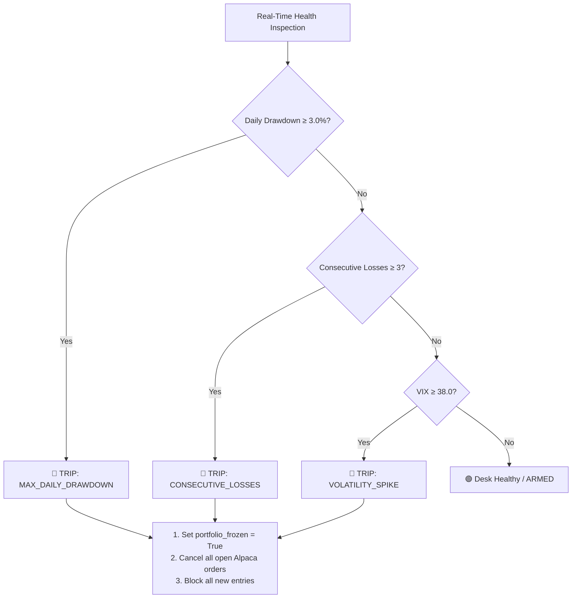

# 📐 ARGUS AI: Technical Architecture & System Specifications

## 1. System Overview

**ARGUS AI** is designed around the concept of **Adversarial Deliberation and Deterministic Guardrails**. Unlike standard predictive trading systems that pass single scalar predictions directly to an execution engine, ARGUS AI forces every trade hypothesis through a 4-tier pipeline:

1. **Thesis Generation Layer**: Independent domain agents evaluate market signals without cross-contamination.
2. **Adversarial Challenge Layer**: A dedicated adversarial agent (Devil's Advocate) stress-tests the trade hypothesis to uncover structural risks.
3. **Deterministic Governance Layer**: Mathematical risk parameters (ATR brackets, equity budgeting) and circuit breakers validate trade safety.
4. **Execution & Audit Layer**: Orders are formatted into bracket structures for Alpaca, while full deliberation provenance is archived to immutable Trade Passports.

---

## 2. Mathematical Scoring & Consensus Synthesis

### 2.1 Multi-Agent Composite Score
Each domain agent outputs a directional score $S_i \in [-100, +100]$ and a confidence level $C_i \in [0.0, 1.0]$. The committee orchestrator computes the weighted composite score $S_{\text{composite}}$ and average confidence $C_{\text{avg}}$:

$$S_{\text{composite}} = w_{\text{quant}} S_{\text{quant}} + w_{\text{news}} S_{\text{news}} + w_{\text{macro}} S_{\text{macro}}$$

$$C_{\text{avg}} = w_{\text{quant}} C_{\text{quant}} + w_{\text{news}} C_{\text{news}} + w_{\text{macro}} C_{\text{macro}}$$

**Standard Institutional Weights:**
- $w_{\text{quant}} = 0.40$ (Technical alignment, momentum, volatility)
- $w_{\text{news}} = 0.30$ (Headline sentiment, filings, earnings)
- $w_{\text{macro}} = 0.30$ (Sector rotation, index beta, VIX regime)

### 2.2 Directional Classification
$$\text{Proposed Direction} = \begin{cases} \text{LONG} & \text{if } S_{\text{composite}} \ge 0 \\ \text{SHORT} & \text{if } S_{\text{composite}} < 0 \end{cases}$$

---

## 3. The Devil's Advocate Adversarial Engine

The **Devil's Advocate** agent assesses the proposed direction against counter-indicators, structural liquidity zones, and volatility regimes. It computes the **Disqualification Risk Percentage** $R_{\text{trap}} \in [0\%, 100\%]$:

### 3.1 Trap Detection Matrix
- **Overbought/Oversold Momentum Trap**:
  - If proposed direction is LONG and $\text{RSI}_{14} > 68.0 \implies +28\%$ risk
  - If proposed direction is SHORT and $\text{RSI}_{14} < 35.0 \implies +28\%$ risk
- **Elevated Volatility Regime**:
  - If $\text{VIX} > 24.0 \implies +25\%$ risk
- **Choppy / Range-Bound Fakeout**:
  - If Market Regime is `CHOPPY` $\implies +18\%$ risk
- **Counter-Trend Fighting**:
  - If proposed direction is SHORT in `BULLISH` regime $\implies +30\%$ risk

### 3.2 Consensus Decision Matrix

$$\text{Decision Status} = \begin{cases} 
\text{VETOED} & \text{if } R_{\text{trap}} \ge 75.0\% \text{ or } \text{veto\_recommended} = \text{True} \\
\text{REJECTED} & \text{if } |S_{\text{composite}}| < 25.0 \\
\text{DOWNSIZED} & \text{if } 45.0\% \le R_{\text{trap}} < 75.0\% \\
\text{APPROVED} & \text{otherwise}
\end{cases}$$

$$\text{Downsize Factor } \delta = \begin{cases} 
0.0 & \text{if VETOED or REJECTED} \\
0.50 & \text{if DOWNSIZED} \\
1.00 & \text{if APPROVED}
\end{cases}$$

---

## 4. Risk Commander & Bracket Derivation

Risk parameters are strictly deterministic to ensure no hallucination or emotional override affects capital preservation.

### 4.1 Bracket Price Calculations
Using the 14-period Average True Range ($\text{ATR}_{14}$):

$$\text{Stop Loss Distance } D_{\text{SL}} = 1.50 \times \text{ATR}_{14}$$
$$\text{Take Profit Distance } D_{\text{TP}} = D_{\text{SL}} \times \text{RR}_{\text{min}} \quad (\text{where } \text{RR}_{\text{min}} = 2.00)$$

For LONG positions:
$$\text{Target Entry} = P_{\text{current}}$$
$$\text{Stop Loss} = P_{\text{current}} - D_{\text{SL}}$$
$$\text{Take Profit} = P_{\text{current}} + D_{\text{TP}}$$

For SHORT positions:
$$\text{Target Entry} = P_{\text{current}}$$
$$\text{Stop Loss} = P_{\text{current}} + D_{\text{SL}}$$
$$\text{Take Profit} = P_{\text{current}} - D_{\text{TP}}$$

### 4.2 Capital Allocation & Position Sizing
Given total account equity $E$ and maximum single-trade account risk budget $\rho = 1.0\%$:

$$\text{Base Risk Budget (USD)} = E \times \left(\frac{\rho}{100}\right)$$
$$\text{Adjusted Risk Budget (USD)} B_{\text{adj}} = \text{Base Risk Budget} \times \delta$$
$$\text{Risk Per Share } R_{\text{share}} = |\text{Target Entry} - \text{Stop Loss}|$$
$$\text{Calculated Shares } N_{\text{shares}} = \frac{B_{\text{adj}}}{R_{\text{share}}}$$

$$\text{Allocated Position Value } V_{\text{pos}} = N_{\text{shares}} \times P_{\text{current}}$$

**Exposure Ceiling:** If $V_{\text{pos}} > 0.20 \times E$, $V_{\text{pos}}$ is capped at $20\%$ of portfolio equity, and $N_{\text{shares}}$ is re-calibrated.

---

## 5. Emergency Kill Switch Circuit Breakers

The `EmergencyKillSwitch` evaluates portfolio metrics before every order submission and during real-time polling:

---

## 6. Auditability & Reflection Loop

1. **Pre-Trade Capture**: Every committee vote, Devil's Advocate objection, risk calculation, and Alpaca order ID is bundled into a cryptographic-style JSON Trade Passport.
2. **Post-Trade Attribution**: When a trade closes (stop-loss hit or take-profit reached), the `AuditAgent` queries market outcomes and logs a 3-sentence executive reflection validating whether the Devil's Advocate's warnings materialized.
